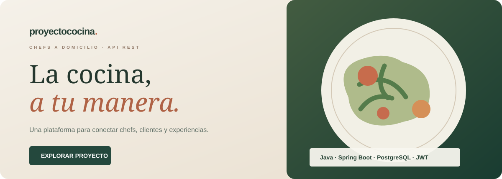

<div align="center">

<a href="https://juanjogamero.github.io/API-ProyectoCocina/">
  
</a>

# Proyecto Cocina
**Plataforma gastronómica · Gestión de chefs y contrataciones**

[**Explorar la plataforma**](https://juanjogamero.github.io/API-ProyectoCocina/) · [**Código Java**](src/main/java/proyecto) · [**Documentación técnica**](Documentacion/ARQUITECTURA.md)

</div>

---

### Una experiencia que puedes explorar

La plataforma ocupa toda la pantalla, con navegación lateral, categorías gastronómicas, fichas de chefs y una agenda integrada. El diseño conserva la identidad coral, sin bordes de maqueta ni marcos decorativos. Puedes **buscar por especialidad, ordenar por precio o nombre, guardar favoritos, abrir fichas detalladas y crear solicitudes de reserva de ejemplo** para gestionar su estado desde tu agenda.

**[Abrir el directorio de Proyecto Cocina](https://juanjogamero.github.io/API-ProyectoCocina/)**

> La interfaz es una **experiencia interactiva independiente** del backend Java. Los cuatro perfiles, sus precios y valoraciones son ficticios. La agenda funciona en el navegador: no procesa pagos ni reservas reales.

Las fotografías de cocina y de los platos proceden de **[Unsplash](https://unsplash.com/)**. Son fotografías reales de banco de imágenes, utilizadas como referencia gastronómica y **no como fotografías de los chefs ficticios**. [Fuentes y licencia](docs/FOTOGRAFIAS.md).

### El proyecto por dentro

Proyecto académico colaborativo desarrollado durante **DAM**, ampliado como trabajo de portfolio. La API permite gestionar clientes y chefs, contratos por fecha y estados de servicio, con seguridad y persistencia.

| Backend REST | Plataforma web |
| --- | --- |
| Java 17 · Spring Boot 3.5.5 | HTML · CSS · JavaScript |
| Spring Security · JWT · BCrypt | Búsqueda, filtros y favoritos |
| PostgreSQL · Spring Data JPA | Fichas de chefs y solicitudes locales |
| Validación, Swagger y pruebas | Diseño responsive · GitHub Pages |

### Ejecutar el backend

Necesitas Java 17 y Docker. Desde la raíz del repositorio:

```bash
docker compose up -d
export JWT_SECRET="$(openssl rand -base64 48)"
./mvnw spring-boot:run
```

En Windows PowerShell:

```powershell
docker compose up -d
$env:JWT_SECRET = [Convert]::ToBase64String([Security.Cryptography.RandomNumberGenerator]::GetBytes(48))
.\mvnw.cmd spring-boot:run
```

La API se prueba en [Swagger UI](http://localhost:8080/swagger-ui.html). Para ejecutar las pruebas automáticas: `./mvnw test`.

El servidor necesita una clave JWT propia de al menos 32 bytes y PostgreSQL disponible. La [guía de arquitectura](Documentacion/ARQUITECTURA.md) explica los roles, los endpoints y las reglas de contratación.

### Organización

```text
src/main/java/proyecto/   API REST de clientes, chefs y contratos
src/test/                 Pruebas automatizadas
docs/                     Web interactiva para GitHub Pages
Documentacion/            Arquitectura y referencia de la API
scripts/                  Pruebas de la interfaz
.github/workflows/        CI y publicación
```

### Origen y autoría

Este repositorio conserva la procedencia del trabajo de clase realizado con un compañero. Es un **fork de [Josemajr6/GestionCocina-Spring](https://github.com/Josemajr6/GestionCocina-Spring)**, ampliado con mejoras en el backend, documentación y una interfaz de demostración.

**Alcance:** la portada del README es una representación gráfica del diseño; las solicitudes dibujadas en ella son ejemplos. La web es una muestra técnica de portfolio, no un marketplace operativo. El backend no está conectado a la web publicada ni gestiona clientes reales.

---

<div align="center">

**[Visitar Proyecto Cocina](https://juanjogamero.github.io/API-ProyectoCocina/)**

<sub>Proyecto Cocina · Java · Spring Boot · PostgreSQL · JWT</sub>

</div>
